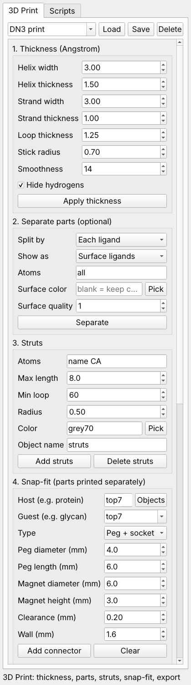
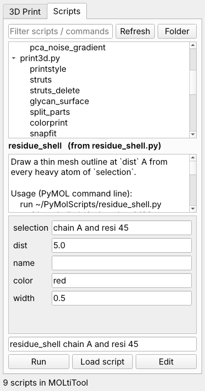
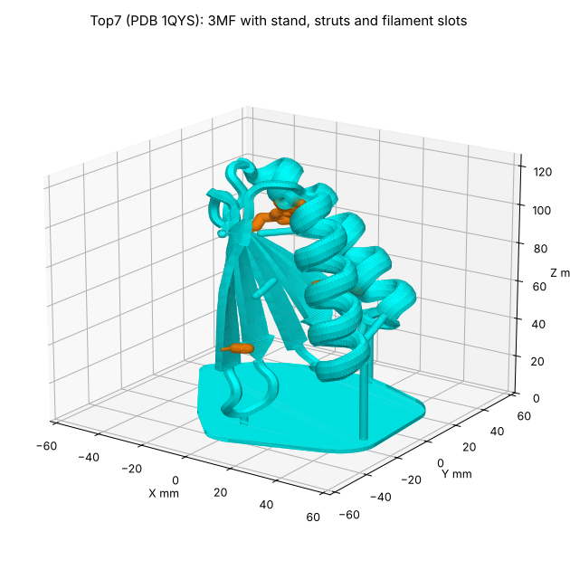

<p align="center"></p>

A pocket multitool for PyMOL: a tidy home for your scripts, with a GUI that finds them for you, plus a set of tools that turn a PyMOL scene into a printable (multi-color) 3D model.

| Script Hub: 3D printing | Script Hub: your scripts | Exported 3MF |
|---|---|---|
|  |  |  |

## What's inside

**Script Hub** (`script_hub.py`): a panel docked in PyMOL.
- **Scripts tab:** lists every `.py` file in this folder together with the commands each one adds (found automatically, without running anything). Pick a command, fill in a form generated from its arguments and press Run. The exact command line appears in the PyMOL log. Drop a new script into the folder and press Refresh.
- **3D Print tab:** the print3d tools below, with presets, a fold-out "About" note in every section, a reset button beside every setting (plus **Defaults** for the whole tab) and a pop-up when an export is done.

**print3d** (`3d_printing/print3d.py`, `3d_printing/print3d_core.py`): from PyMOL scene to print.
- `printstyle`: thicker cartoon (helix, strand, loop) and sticks, in real Angstrom widths; double and aromatic bonds as one full stick; optional solid-cylinder helices
- `surfacestyle`: surface resolution (draft to maximum), probe radius, molecular or solvent-accessible surface, smoothed edges
- `split_parts`: separate ligands (substrates, cofactors, inhibitors) or chains into their own objects, each surfaced on its own so nothing cuts into it
- `struts`: support rods between residues close in space but far along the chain (same rules as ChimeraX `struts`), joined to the cartoon's center line so they meet beta strands squarely, colored like their chain; click a strut and press Delete (or Remove selected) to remove it, show ID labels, or add one between any two residues
- `snapfit`: join two separately printed parts at their contact with a peg and walled socket, or magnet pockets, with a seat cut to shape and print clearance
- `colorprint`: export with your colors
  - **3MF** opens ready to slice in OrcaSlicer, Anycubic Slicer Next and Bambu Studio, with every part already on its filament slot (and painted where colors mix)
  - **OBJ** with vertex colors, or **STL** per filament
  - sized to a longest side in mm, oriented the way you see it on screen
  - colors snapped to the filaments you have loaded, or `filaments=auto` (or `auto_filaments`) to pick common PLA colors closest to the scene
  - **less support to pick out** (all optional): fill each helix with a core rod (`helix_core=1`), turn the model for the least overhang (`orient=min_support`), and paint the faces that will need support in the preview (`show_overhang=1`)
  - **single-color printer mode:** one file per color, smaller pieces plug into sockets in bigger ones
  - optional flat-cut bottom or a stand with pillars
  - tuned to your nozzle and layer height (thinnest feature, fit clearances, base sizes in whole layers)
  - **printer profiles** for Anycubic (Kobra X, Kobra 3, Kobra S1, S1 Max, Kobra 3 Max), Bambu Lab (A1 mini, A1, A2L, P1S/P1P, X1 Carbon), Prusa (MINI+, MK4S, CORE One) and Creality (K1C, K2 Plus), or type your own build volume: the report says whether the model fits and whether it uses more colors than you have filament slots, and `fit=1` scales it to fill the printer
  - **Preview in PyMOL**: see the finished print (base, pegs, rods, colors) over your molecule before writing anything, with the build volume drawn around it and anything thinner than your nozzle can print painted red
  - loose pieces (side chains that end just off the cartoon) joined with short rods
  - beta-strand arrows joined solidly to their loops (PyMOL's arrow tip alone is a weak point)
  - a report: size, grams of filament, parts thinner than your nozzle can handle, anything still floating, bed contact
- `print3d_preset`: save and reuse whole setups by name. Four are built in: **Multi-color Printer Cartoon**, **Single Color Printer Cartoon**, **Multi-color Printer Surface** and **Single Color Printer Surface**

**Other PyMOL scripts**

| Script | Command | What it does |
|---|---|---|
| `align_chains.py` | `align_chains` | Superpose one chain of every loaded object onto the same chain of a reference |
| `ray_each.py` | `ray_each` | Ray-trace every object with the current view and save one PNG per object |
| `residue_shell.py` | `residue_shell` | Show the shell of residues within a distance of a selection |
| `show_shifted.py` | `show_shifted` | Highlight residues that moved between two objects |
| `apbs.py` | `apbs_all` | Electrostatics (pdb2pqr + APBS) for loaded objects |
| `avg_plddt_pymol.py` | `avg_plddt` | Average pLDDT (B-factor) of a selection |
| `pym_netcharge.py` | `net_charge` | Net charge of a selection |
| `pca_noise_gradient.py` | `pca_noise_gradient` | PCA noise-gradient visualization |

**ChimeraX** (`chimerax/colorprint.py`): a `colorprint` command for ChimeraX that exports the displayed scene with colors (vertex-colored OBJ or one STL per color), caps open bond cylinders and merges each color into one solid.

## Install (PyMOL)

1. Clone or download this repository.
2. Add one line to your `~/.pymolrc` (or `~/.pymolrc.py` as `cmd.run(...)`):
   ```
   run /path/to/MOLtiTool/script_hub.py
   ```
3. Restart PyMOL and open **Plugin > Script Hub**, or type `script_hub`.

The print3d commands are loaded together with the hub. To use them alone: `run /path/to/MOLtiTool/3d_printing/print3d.py`.

**Optional, recommended:** merging solids, snap-fit connectors, bases, single-color sockets and the full printability report use [manifold3d](https://github.com/elalish/manifold). Click **Install merge library** in the panel, or type `print3d_install_merge`. Without it, exports still work (capped pieces instead of merged solids).

To add your own scripts to the hub, put them in this folder. Commands registered with `cmd.extend(...)` show up with a form for their arguments; scripts without commands get a **Run script** button.

## Quick start: print a protein with a bound ligand

```
printstyle 3.0, 1.5, 3.0, 1.0, 1.25, 0.7
color cyan, polymer
set cartoon_color, cyan
show sticks, resi 13+14+56+74 and not name N+C+O
color orange, resi 13+14+56+74 and elem C
color blue, resi 13+14+56+74 and elem N
split_parts myprotein, ligands_together, surface_ligands, green
struts myprotein_polymer and name CA, 8, 60, 0.5, cyan
snapfit myprotein_polymer, myprotein_ligands, peg
colorprint ~/Desktop/model.3mf, each=1, size_mm=120, filaments=cyan orange blue green, base=stand
```

This writes `model_polymer.3mf` (protein, struts and stand) and `model_ligands.3mf` (the ligand, with a peg that clicks into the protein), and prints a report such as:

```
scale 3.32 mm per A, oriented as on screen
filaments: 1=cyan, 2=orange, 3=blue, 4=green
[myprotein_polymer] 101 x 86 x 126 mm, about 60 g if printed solid
   cyan on filament 1: 42.2 g; orange on filament 2: 2.3 g; cyan (stand) on filament 1: 16.2 g
   peg 4.0 x 6.0 mm (+0.20 mm clearance) at 0.9 mm gap
   attached 3 loose piece(s) to the model with 1.5 mm rods
[myprotein_ligands] 21 x 16 x 20 mm, about 4 g if printed solid
```

Tips
- Run `set cartoon_color, <color>` so cartoon segments don't take the color of their CA atom.
- Parts that must fit together (and snap-fit connectors) need to be exported in one `colorprint` call with `each=1`.
- Single-filament printer? Add `single_color=1` and print each file in its color, then glue. A surface prints in its main color.
- Printing a surface instead? `surfacestyle all, 2` then `colorprint ~/Desktop/model.3mf, preset=Multi-color Printer Surface, printer=Bambu Lab A1, size_mm=100`.
- `print3d_printers` lists the printer profiles; add `preview=1` to any `colorprint` to see it in the build volume first.
- Every command has full help: `help colorprint`.

## Install (ChimeraX)

```
open /path/to/MOLtiTool/chimerax/colorprint.py
colorprint ~/Desktop/model.obj
```
For merged solids run `pip install manifold3d` in the ChimeraX command line once.

## Notes

- Developed and tested with open-source PyMOL 3.x (PyQt5) and ChimeraX 1.9. Reports from Incentive PyMOL users are welcome.
- Sizes in the 3D Print tab are full widths and thicknesses in Angstrom. The tool converts them to PyMOL's own cartoon settings.
- The 3MF layout follows OrcaSlicer's reader (one object, one part per filament, `paint_color` for mixed colors).

## How this was made

Fair warning: a good part of this repo was vibe-coded with [Claude](https://claude.ai). That includes Script Hub (`script_hub.py`), the 3D-printing tools (`3d_printing/`), the ChimeraX `colorprint.py` and the banner. They were tested headlessly in open-source PyMOL, but not on every PyMOL build or slicer, so expect a few rough edges and please open an issue when you hit one.

The other scripts (`align_chains.py`, `ray_each.py`, `residue_shell.py`, `show_shifted.py`, `apbs.py`, `avg_plddt_pymol.py`, `pym_netcharge.py`, `pca_noise_gradient.py`) are legacy tools I built over time for my own research and still use.

## Make your own tools

Have a script you keep reaching for? Add it. Any `.py` file in this folder that registers a command with `cmd.extend` shows up in Script Hub with a form for its arguments, so no GUI code is needed:

```python
from pymol import cmd

def count_contacts(selection1, selection2="polymer", cutoff=4.0):
    """
DESCRIPTION

    Count atoms in selection1 within cutoff (A) of selection2.
    """
    n = cmd.count_atoms("(%s) within %s of (%s)" % (selection1, float(cutoff), selection2))
    print(" count_contacts: %d atoms" % n)
    return n

cmd.extend("count_contacts", count_contacts)
```

Save it here, press **Refresh** in the Scripts tab, and it's ready. Pull requests are welcome, from polished tools to small one-off helpers. If you build with an AI coding agent, point it at [AGENTS.md](AGENTS.md): it explains how the hub finds commands, how to add a section to the 3D Print tab, and the PyMOL quirks worth knowing.

## License

MIT, see [LICENSE](LICENSE).
